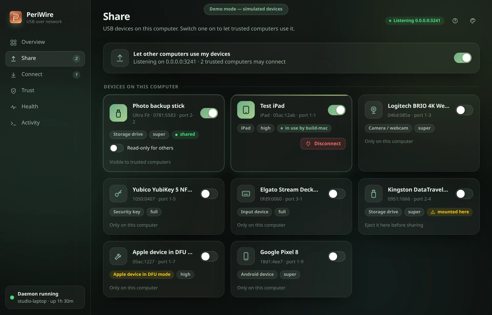
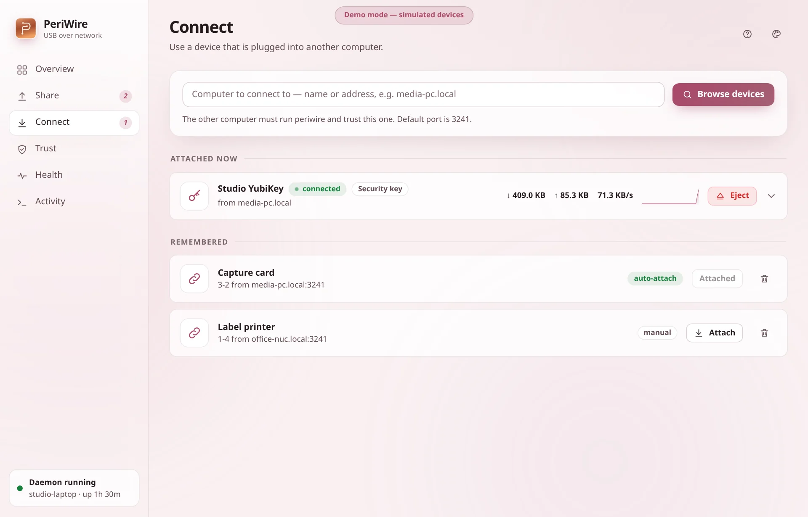

# Getting started

periwire has two roles that every computer can play at once:

- **Sharing** (a.k.a. *exporting*): a device is physically plugged into this computer and other computers may use it.
- **Using** (a.k.a. *importing* or *attaching*): a device that is plugged into another computer shows up here.

Below, computer **A** has the device and computer **B** wants to use it.

## 0. One-time install

Put the `periwire` binary on both computers (see the README). Linux, computer that will *use* devices: `sudo modprobe vhci-hcd` must work (on Ubuntu the module can live in
`linux-modules-extra-$(uname -r)`).

## 1. Start the daemon

| Computer | Command | Why |
|---|---|---|
| A (shares) | `periwire daemon` | Needs permission to open the USB device: run as root, or give your user a udev rule. |
| B (uses), Linux | `sudo periwire daemon` | Attaching devices writes to the kernel's `vhci_hcd`, which needs root. |
| B (uses), macOS | `periwire daemon` | Needs the Apple USB host-controller entitlement; see [MACOS](MACOS.md). |

To keep it running across reboots: `sudo periwire service install` (Linux), then
`sudo usermod -aG periwire $USER` and log in again so your user may talk to the root daemon.
`periwire status` tells you whether the CLI can reach it.

## 2. Share the device (on A)

```bash
periwire devices          # BUSID  ID         DEVICE ...   e.g.  2-2   1234:5678  Example USB Flash Drive
periwire share 2-2        # or by model: periwire share 1234:5678
```

*busid* names a physical port (changes if you re-plug into another port); *vid:pid* names a model (matches any
port, but also any identical second device). A device that is **mounted on A** (a drive that was auto-mounted) cannot be
taken until you eject/unmount it there: periwire refuses rather than yank a filesystem away.

Prefer a window? In the desktop app, switch the device on in **Share**:



## 3. Pair the two computers

Each computer has a certificate and trusts only fingerprints you approved. Both directions are needed.

```bash
# on B: read A's fingerprint straight off the network, compare it with `periwire id` shown on A, answer y
periwire trust host A.local

# on A: trust B (B's fingerprint comes from `periwire id` on B)
periwire trust add 5d1b…(64 hex)… --name B
```

Comparing the fingerprint on both screens is what stops someone on the network from impersonating A.

## 4. Use it (on B)

```bash
periwire remote A.local            # shows what A shares with you
periwire attach A.local 2-2        # the device is now plugged into B
periwire attach A.local 2-2 --auto # …and re-attach automatically after drops/reboots
periwire status
periwire detach 2-2                # safe eject (unmounts first), the device returns to A
```

In the desktop app, **Connect** does the same with a click (browse the other computer, then attach):



## Situations

**Same LAN.** Nothing special; use A's name or IP. Port 3241/TCP must be reachable (check A's firewall).

**Across VLANs / subnets.** Same commands with A's routed address; open 3241/TCP from B to A in the router/firewall.
mDNS names (`.local`) usually do not cross subnets, so use IP addresses or DNS names.

**Into a VM (no passthrough).** Install periwire *inside the VM*, run the daemon there and `attach` from the VM to the
host/laptop that has the device. This avoids hypervisor USB passthrough, which proved unreliable (it destabilised a guest) when the
device itself is network-forwarded. macOS guests need the entitlement ([MACOS](MACOS.md)); Linux guests work today.

**Over the internet.** Use a VPN/overlay (Tailscale, WireGuard) so 3241/TCP is reachable privately, or forward the
port. Connections are mutually authenticated and encrypted either way, but only forward ports on a machine you are
comfortable exposing, and keep the trust list short.

## Taking a device back

On A: `periwire kick 2-2` disconnects whoever is using it immediately (they lose it abruptly; ask them to `detach` first if
they might have files open). `periwire unshare 2-2` stops sharing and also disconnects.

## When it doesn't work

Run `periwire doctor` on both computers; see [TROUBLESHOOTING](TROUBLESHOOTING.md).
