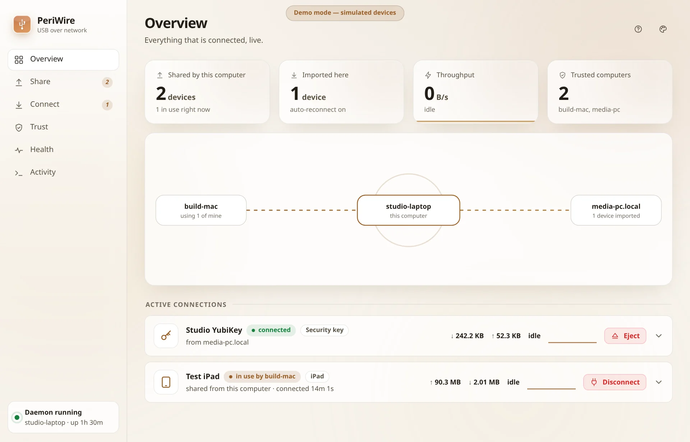
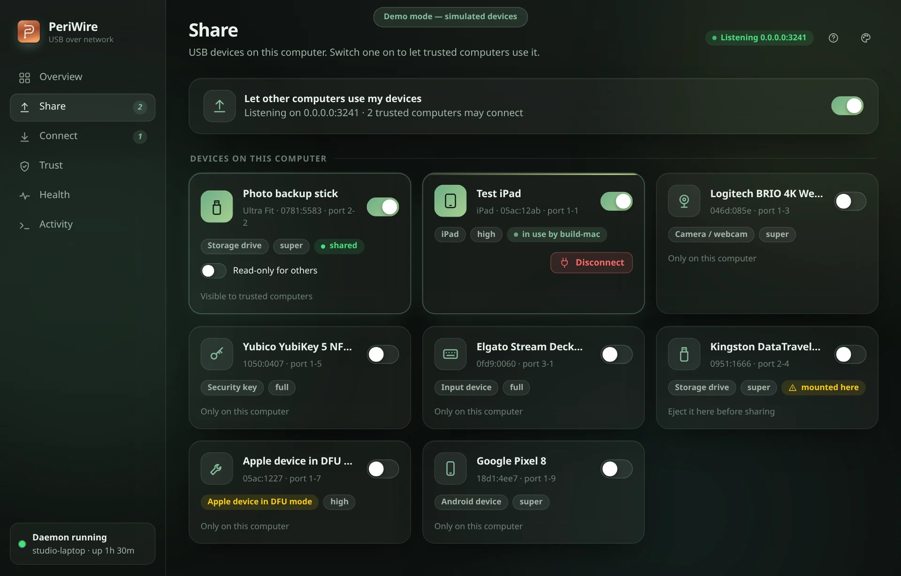
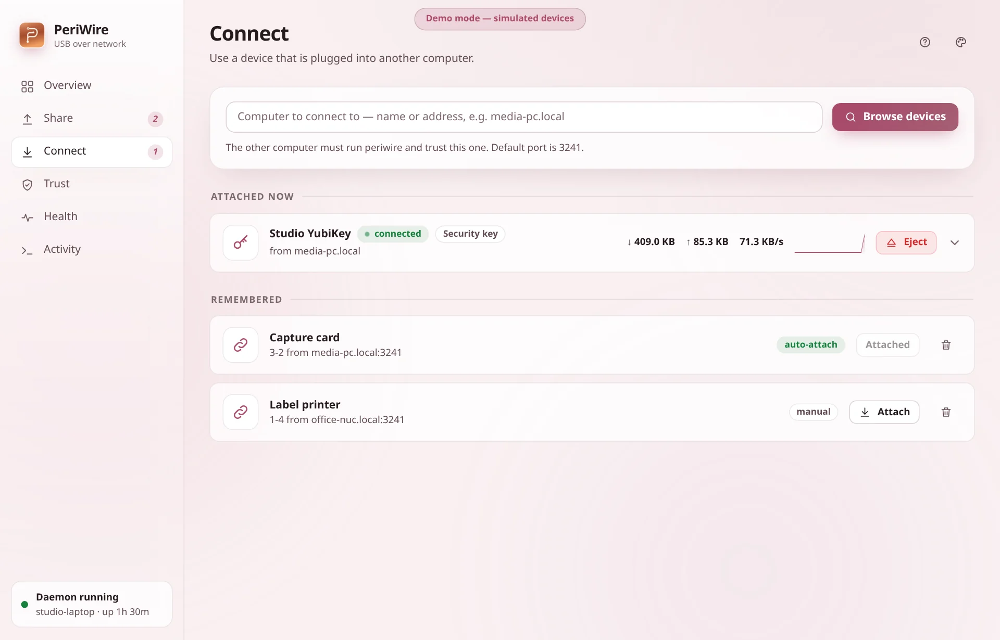
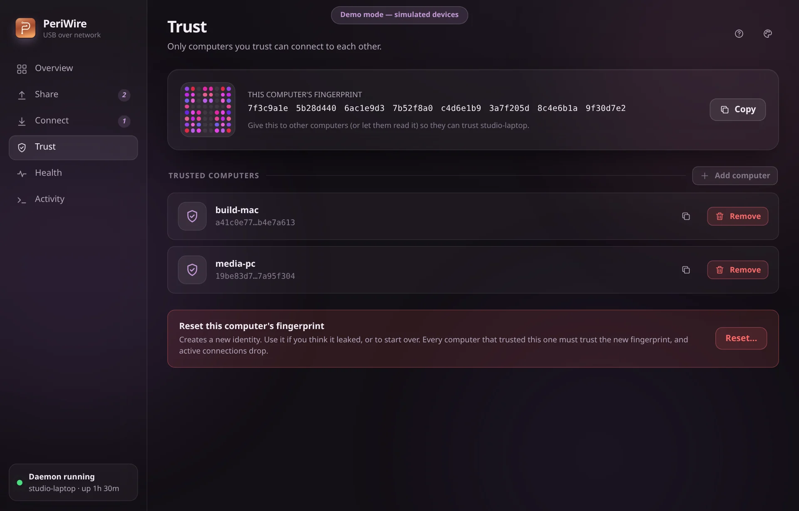
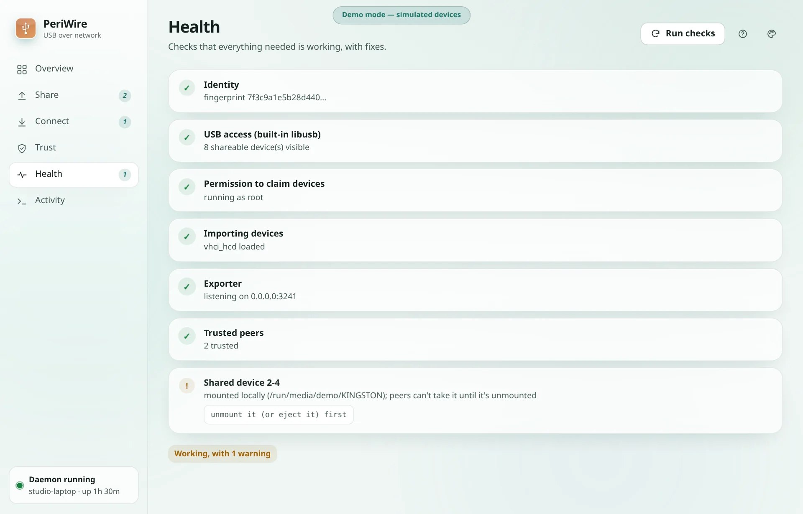
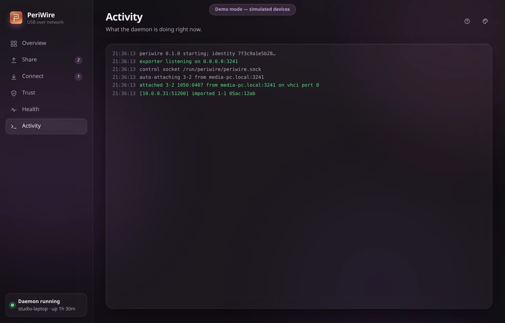
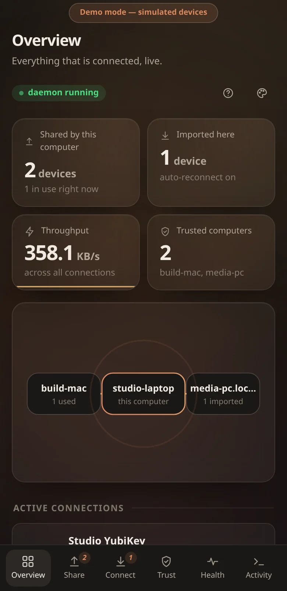
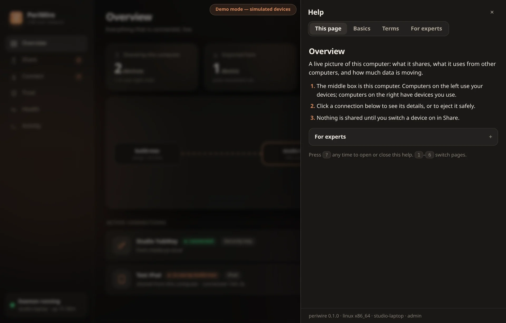
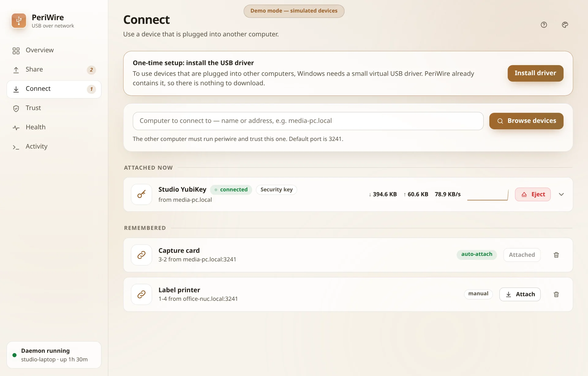
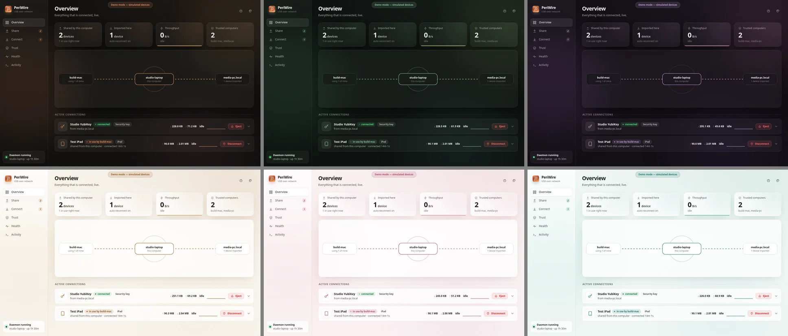

# Desktop app

`periwire-gui` is a [Tauri 2](https://tauri.app) app: a window plus a tray (menu-bar / system-tray) icon that mirrors the
daemon in real time. It is a control panel only — the **daemon does the work**, so devices keep flowing when the window
is closed and the app can be restarted any time.

<p align="center">
  <picture>
    <source media="(prefers-color-scheme: dark)" srcset="img/overview-dark.webp">
    
  </picture>
</p>

## What you get

- **Overview** (above) — live tiles (shared, imported, throughput), an animated topology map, and every active connection with
  speed graphs and Eject / Disconnect buttons.
- **Share** — every USB device on this computer with a switch; "in use by …" and "mounted here" shown on the card.

  
- **Connect** — browse another computer, attach with one click, optional automatic reconnect, remembered connections.

  
- **Trust** — your fingerprint (with a visual identicon), trusted computers, and a guided "read fingerprint → compare →
  trust" flow.

  
- **Health** — the `doctor` checks with fixes. **Activity** — the live daemon log.

   
- **Tray** — icon turns green while anything is connected and amber when the daemon is down; the menu lists imported
  devices with one-click *Eject*, shared devices in use with *Disconnect*, and *Start daemon* when it is not running.
  Closing the window hides it to the tray; *Quit* in the tray menu exits.
- The tray icon belongs to this app, not to the daemon: start `periwire-gui` (closing its window hides it to the tray) to get the icon. The daemon alone has no icon.
- If the daemon is not running the app offers *Start daemon* (and, on Linux, *Start with admin rights* via `pkexec`).
- Keyboard: `1`–`6` switch pages, `Esc` closes dialogs. Follows the OS light/dark setting; respects reduced motion.

- **Names people recognise.** Devices show their label (hover a card and click the pencil to rename one), or product name, plus a
  kind such as *Storage drive*, *Android device*, *iPad*, *Apple device in DFU mode*. Connection cards show the same, with the raw
  ids tucked behind a click. Computers you browse show the names *they* report.
- **Fits any screen.** Sidebar → icon rail → bottom tab bar on phones and narrow windows; cards reflow to one column.

  
- **Reset fingerprint** lives at the bottom of Trust.

## Run

```bash
cargo run --release -p periwire-gui            # development
target/release/periwire-gui --hidden           # start minimised to the tray (autostart entries)
```

The app finds the daemon's socket automatically (`PERIWIRE_SOCKET` overrides). It looks for the `periwire` binary next to
itself, then in `PATH`, when asked to start the daemon.

## Build dependencies

Linux: `libwebkit2gtk-4.1-dev libgtk-3-dev libayatana-appindicator3-dev librsvg2-dev libsoup-3.0-dev`
(Debian/Ubuntu names). macOS and Windows use the system webview and need nothing extra.
Installers/bundles (`.deb`, `.AppImage`, `.dmg`, `.msi`) need the Tauri CLI: `cargo install tauri-cli --version "^2"`,
then `cd gui/src-tauri && cargo tauri build`. Regenerate icons with `python3 tools/make-icons.py` (or
`cargo tauri icon` from a source PNG).

## Demo mode (no daemon, no devices)

The UI in `gui/ui/` is plain HTML/CSS/JS. Served by any static server and opened in a browser it runs against a
built-in **simulated daemon** (fake devices and traffic), which is safe for exploring, screenshots and design work:

```bash
python3 -m http.server 8765 --directory gui/ui    # then open http://localhost:8765/
```
Add `?demo` to force demo mode inside the desktop app.

## How it talks to the daemon

The Rust side exposes one command, `api(method, params)`, which forwards to the daemon's [control API](API.md), and
runs a background task that subscribes to events, refreshes the tray, and emits `periwire-status`, `periwire-event`,
`periwire-connection` and `periwire-toast` events to the page. There are no network requests from the UI.

## Built-in help



The **?** button in the top bar (or the `?` key) opens a help drawer with four tabs: *This page* (what the current page shows and how to
use it, in a few plain steps, with the expert detail folded away), *Basics* (three steps to share and use a device), *Terms* (a plain-English
glossary) and *For experts* (protocol, ports, files, speed, limits and a command-line cheat sheet). A fresh install also shows a
*Getting started* card on Overview that ticks itself off as you share a device, trust a computer and attach something; it can be dismissed.
All the text is in `gui/ui/help.js`, and a test (`help_matches_cli`) fails the build if that file mentions a `periwire` command or flag that
does not exist, so the help cannot silently drift from the CLI. Demo mode: `?demo&fresh` shows a brand-new install.

## Read-only switch

On **Connect**, the *Read-only* switch next to *Reconnect automatically* decides how a device is attached (default off = read and
write). Each attached device also has its own *Read-only* switch (open the item); sliding it safely ejects and re-attaches the drive
in the other mode, because the write protection is enforced by the computer the drive is plugged into. Read-only is available for
USB storage; other devices are refused in that mode.

Sharing has the same idea from the owner's side: a shared USB drive card on **Share** has a *Read-only for others* switch. With it on,
every computer that imports the drive gets it write-protected. Changing it disconnects a current user (they reconnect under the new rule).

## Windows: one-click driver install



On Windows, when the virtual USB driver is missing, the **Connect** page shows a "One-time setup" banner with an
**Install driver** button. It asks for confirmation, then calls the daemon (`driver.install`), which unpacks and installs the
signed driver carried inside PeriWire and reports whether Windows wants a restart. The daemon must run as Administrator (for
example via `periwire service install`); otherwise the app says so. Try it in demo mode with `?demo&win`.

## Themes

The palette button in the top-right corner opens the theme picker: three dark themes (Clay, Moss, Plum), three light themes (Linen, Rose, Lagoon), or **Match system**. The choice is remembered on that device.


